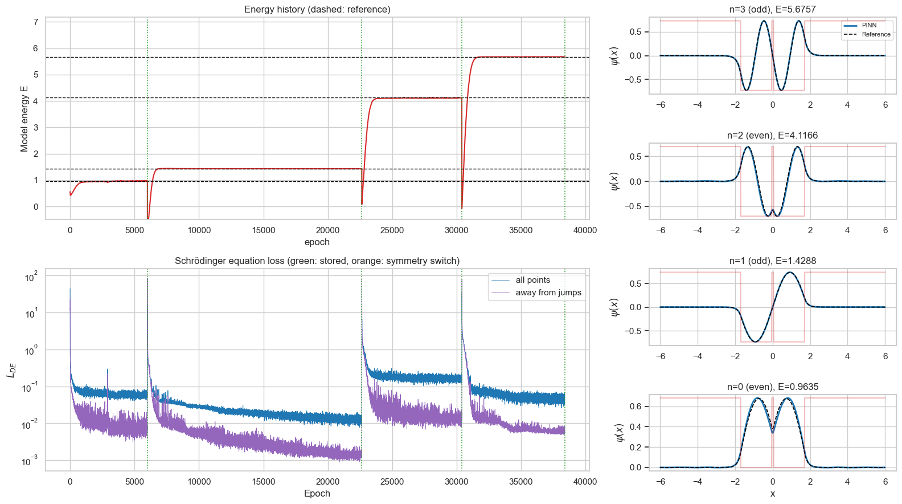
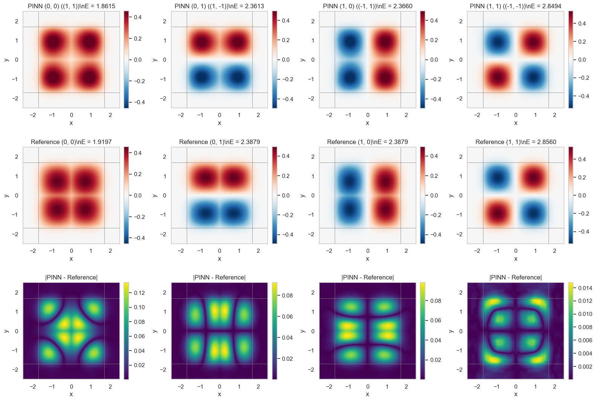
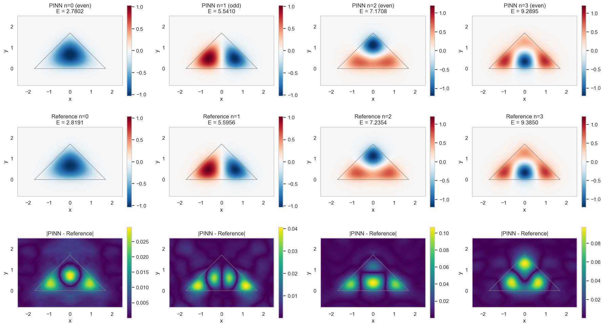

# Quantum Wells with PINNs

PyTorch physics-informed neural networks (PINNs) learn bound-state wave functions $\psi$ and energies $E$ by minimizing the stationary Schrödinger-equation residual at sampled points:

$$-\frac{1}{2}\nabla^2\psi + V\psi = E\psi.$$

Automatic differentiation supplies the spatial derivatives. Each notebook compares the learned states with a finite-difference reference solution.

## Boundary conditions and constraints

- **Boundary conditions:** A boundary factor enforces $\psi=0$ at $x=\pm6$ in 1D and on the outer edges of $[-6,6]^2$ in 2D, approximating decay far outside the well. Finite barriers allow penetration; the wave function is not forced to vanish at the well edges or central walls.
- **Normalization:** $\int_\Omega |\psi|^2\,d\Omega=1$ gives unit total probability for one particle. A normalization penalty sets the amplitude, while dividing the equation loss by the estimated norm discourages collapse toward zero. The 2D notebooks estimate normalization over a smaller box containing the localized states.
- **Symmetry:** Reflected network features target even or odd parity, $\psi(-x)=\pm\psi(x)$. The square well uses parity in both coordinates; the triangle uses only reflection in $x$.
- **Distinct states:** Orthogonality separates excited states from previously learned states, using Gram–Schmidt projection in the 1D and triangular notebooks and an overlap penalty in the 2D square notebook.

## Files and examples

### 1. One-dimensional finite well with a central wall

[`finite_square_well_central_wall_PINN.ipynb`](finite_square_well_central_wall_PINN.ipynb) models a well of half-width 1.7 with a thin finite barrier at the center. It searches even and odd states and compares energies, wave functions, and training losses.

### 2. Two-dimensional finite square well with central walls

[`finite_square_well_2d_central_walls_PINN.ipynb`](finite_square_well_2d_central_walls_PINN.ipynb) uses the separable potential $V(x,y)=V_1(x)+V_1(y)$, creating crossed central barriers. It searches four parity classes and checks against products of 1D reference states. The image below shows the potential.

### 3. Two-dimensional triangular finite well

[`triangular_finite_well_PINN.ipynb`](triangular_finite_well_PINN.ipynb) uses a triangular interior with vertices $(-1.7,0)$, $(0,1.7)$, and $(1.7,0)$ and a finite exterior barrier. It searches both $x$-parities and compares against a 2D finite-difference solution.

The PNG files illustrate these examples. Open a notebook and run its cells in order to train and inspect the results.
